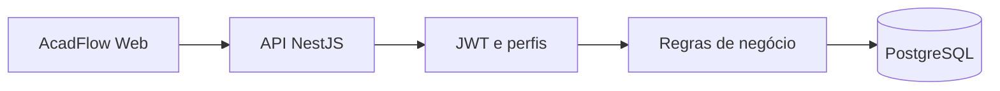
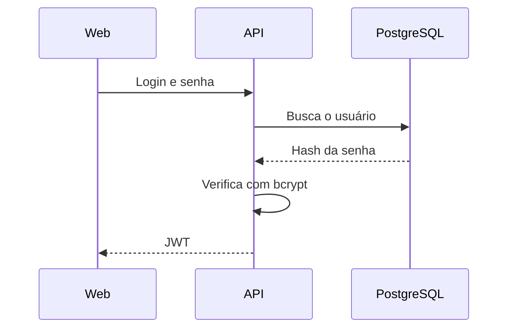

<div align="center">
  

  # AcadFlow — API

  API de gestão acadêmica para organizar disciplinas, atividades e notas.

  [Documentação no Linear](https://linear.app/acadflow/document/acadflow-inicio-e-documentacao-9f01545a3125)
</div>

## Sobre

A API do AcadFlow atende professores, que cadastram disciplinas, atividades e notas, e alunos, que acompanham o próprio desempenho. A autenticação usa login e senha, com hash bcrypt e JWT, e o acesso é controlado por perfil (`PROFESSOR` e `ALUNO`).

**Tecnologias:** `NestJS` · `TypeScript` · `PostgreSQL` · `TypeORM` · `JWT` · `bcrypt` · `Jest` · `Supertest` · `GitHub Actions`

> Projeto em fase inicial: o código ainda não foi adicionado.

## Arquitetura





## Endpoints

| Método | Rota | O que faz |
| --- | --- | --- |
| `POST` | `/auth/register` | Cadastra um usuário |
| `POST` | `/auth/login` | Autentica e retorna o JWT |
| `GET` | `/disciplines` | Lista disciplinas |
| `POST` | `/disciplines` | Cadastra uma disciplina (professor) |
| `GET` | `/activities` | Lista atividades |
| `POST` | `/activities` | Cria uma atividade (professor) |
| `GET` | `/grades` | Consulta notas |
| `POST` | `/grades` | Lança uma nota (professor) |

> Rotas previstas, sujeitas a mudança na implementação.

## Como executar

```bash
cp .env.example .env
pnpm install
pnpm start:dev
```

> Comandos previstos: passam a valer quando a estrutura inicial for adicionada.

## Documentação

| Página | O que terá |
| --- | --- |
| [Linear](https://linear.app/acadflow/document/acadflow-inicio-e-documentacao-9f01545a3125) | Início e documentação do projeto |
| `docs/stack.md` | Tecnologias, versões e responsabilidades |
| `docs/arquitetura.md` | Organização, decisões e integrações |
| `docs/configuracao.md` | Variáveis de ambiente e inicialização |
| `docs/testes.md` | Tipos de teste, execução e scripts |
| `docs/CI.md` | Pipelines, CHANGELOG e versionamento |
| `docs/diagramas/modelo-de-dados.md` | Entidades, tabelas e relacionamentos |
| `docs/diagramas/sequencia.md` | Fluxos principais e requisições |

> Os arquivos de `docs/` serão criados ao longo do projeto.

## Repositórios

- [acadflow-web](https://github.com/DevCaverna/acadflow-web)
- [acadflow-design](https://github.com/DevCaverna/acadflow-design)

## Referências

- [NestJS — Documentação](https://docs.nestjs.com/)
- [TypeORM — Documentação](https://typeorm.io/)
- [TypeScript — Documentação](https://www.typescriptlang.org/docs/)
- [Mermaid — Diagramas](https://mermaid.js.org/intro/)
