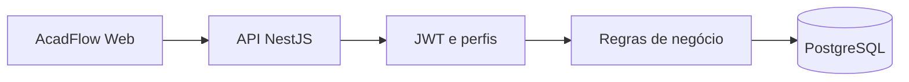
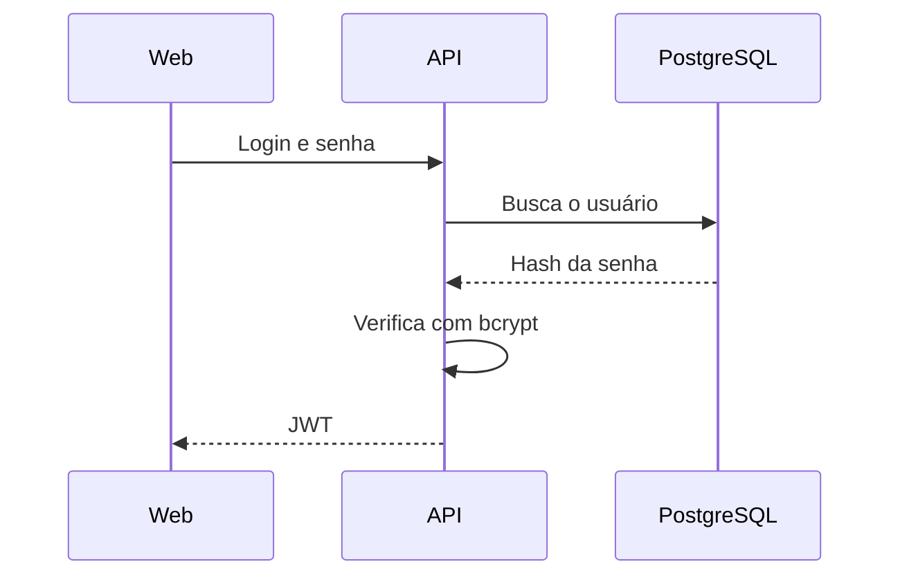

<div align="center">
  

# AcadFlow — API

API de gestão acadêmica para organizar disciplinas, atividades e notas.

[Documentação no Linear](https://linear.app/acadflow/document/acadflow-inicio-e-documentacao-9f01545a3125)
</div>

## Sobre

A API do AcadFlow atende professores, que cadastram disciplinas, atividades e notas, e alunos, que acompanham o próprio desempenho. A autenticação usa login e senha, com hash bcrypt e JWT, e o acesso é controlado por perfil (`PROFESSOR` e `ALUNO`).

**Tecnologias:** `NestJS` · `TypeScript` · `PostgreSQL` · `TypeORM` · `JWT` · `bcrypt` · `Vitest` · `Supertest` · `GitHub Actions`

## Arquitetura





## Endpoints

| Método         | Rota                                | O que faz                     |
| -------------- | ----------------------------------- | ----------------------------- |
| `GET`          | `/health`                           | Estado da API e do banco      |
| `POST`         | `/auth/login`                       | Autentica e retorna o JWT     |
| `GET`          | `/auth/me`                          | Retorna o usuário autenticado |
| `GET` / `POST` | `/disciplines`                      | Lista ou cadastra disciplinas |
| `GET`          | `/disciplines/:id`                  | Consulta uma disciplina       |
| `GET`          | `/disciplines/:id/students`         | Lista alunos matriculados     |
| `GET` / `POST` | `/disciplines/:id/activities`       | Lista ou cria atividades      |
| `GET`          | `/disciplines/:id/grades`           | Notas da turma (professor)    |
| `GET`          | `/disciplines/:id/grades/me`        | Notas e média do aluno        |
| `PUT`          | `/activities/:id/grades/:studentId` | Lança ou atualiza uma nota    |

> Rotas do MVP. Detalhes em [contratos-api.md](docs/contratos-api.md).

## Como executar

```bash
cp .env.example .env
pnpm install
pnpm start:dev
```

> Exige PostgreSQL em execução. Veja [docs/execucao](docs/execucao/README.md) para rodar com Docker.

## Documentação

| Página                                                                                     | O que tem                                |
| ------------------------------------------------------------------------------------------ | ---------------------------------------- |
| [Linear](https://linear.app/acadflow/document/acadflow-inicio-e-documentacao-9f01545a3125) | Início e documentação do projeto         |
| [Execução](docs/execucao/README.md)                                                        | Como rodar, testar e resolver problemas  |
| [Arquitetura](docs/arquitetura.md)                                                         | Organização e decisões                   |
| [Configuração](docs/configuracao.md)                                                       | Variáveis de ambiente                    |
| [Testes](docs/testes.md)                                                                   | Tipos de teste e comandos                |
| [CI](docs/CI.md)                                                                           | Pipeline e branches                      |
| [Qualidade e editores](docs/qualidade-e-editores.md)                                       | Oxlint, Oxfmt, TypeScript, VS Code e Zed |
| [Contratos REST](docs/contratos-api.md)                                                    | Rotas, tipos e erros                     |
| [Migrations](docs/migrations.md)                                                           | Padrão de migrations                     |
| [AGENTS.md](AGENTS.md)                                                                     | Diretrizes para colaboradores e agentes  |

## Repositórios

- [acadflow-web](https://github.com/DevCaverna/acadflow-web)
- [acadflow-design](https://github.com/DevCaverna/acadflow-design)

## Referências

- [NestJS — Documentação](https://docs.nestjs.com/)
- [TypeORM — Documentação](https://typeorm.io/)
- [TypeScript — Documentação](https://www.typescriptlang.org/docs/)
- [Mermaid — Diagramas](https://mermaid.js.org/intro/)
