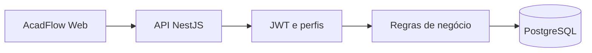
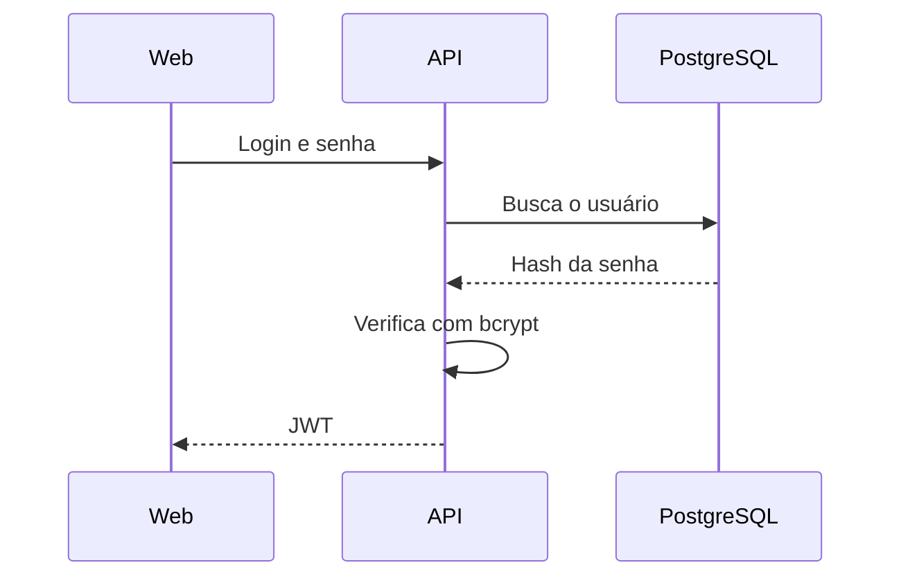

<div align="center">
  

# AcadFlow — API

API de gestão acadêmica para organizar disciplinas, atividades e notas.

[Documentação no Linear](https://linear.app/acadflow/document/acadflow-inicio-e-documentacao-9f01545a3125)
</div>

## Sobre

A API do AcadFlow atende professores, que cadastram disciplinas, atividades e notas, e alunos, que acompanham o próprio desempenho. A autenticação usa login e senha, com hash bcrypt e JWT, e o acesso é controlado por perfil (`PROFESSOR` e `ALUNO`).

O sistema centraliza prazos, lançamento de notas e consulta de médias, evitando que essas informações precisem ser mantidas e comunicadas separadamente. A versão de referência da atividade **Operação Deploy**, da disciplina de Gerência de Configuração e Manutenção de Software (Engenharia de Software, UTFPR-CP), é a [v1.1.0](https://github.com/DevCaverna/acadflow-api/releases/tag/v1.1.0).

**Tecnologias:** `Node.js` · `pnpm` · `NestJS` · `TypeScript` · `PostgreSQL` · `TypeORM` · `JWT` · `bcrypt` · `Vitest` · `Supertest` · `Docker` · `GitHub Actions`

## Equipe

DevCaverna é a organização no GitHub; a equipe não tem nome próprio.

- Mauricio Alves de Aquino ([@aqu1no1](https://github.com/aqu1no1)): implementação da maior parte das funcionalidades.
- Otávio Luiz Gonzaga ([@OtavioGonzaga](https://github.com/OtavioGonzaga)): entrega contínua, releases, deploy e configuração.
- Vinícius Antônio de Oliveira ([@Vinicius-Antonio](https://github.com/Vinicius-Antonio)): integração contínua e elaboração do relatório técnico.

## Ambientes publicados

| Ambiente        | Front-End                                              | API                                                                |
| --------------- | ------------------------------------------------------ | ------------------------------------------------------------------ |
| Produção        | [Aplicação](https://acadflow.duckdns.org/)             | [API — saúde](https://acadflow-api.duckdns.org/health)             |
| Homologação     | [Aplicação](https://acadflow-staging.duckdns.org/)     | [API — saúde](https://acadflow-api-staging.duckdns.org/health)     |
| Desenvolvimento | [Aplicação](https://acadflow-development.duckdns.org/) | [API — saúde](https://acadflow-api-development.duckdns.org/health) |

## Arquitetura





## Endpoints

| Método         | Rota                                | O que faz                        |
| -------------- | ----------------------------------- | -------------------------------- |
| `GET`          | `/health`                           | Estado da API e do banco         |
| `POST`         | `/auth/login`                       | Autentica e retorna o JWT        |
| `POST`         | `/auth/register`                    | Cria uma conta e inicia a sessão |
| `GET`          | `/auth/me`                          | Retorna o usuário autenticado    |
| `GET` / `POST` | `/disciplines`                      | Lista ou cadastra disciplinas    |
| `GET`          | `/disciplines/:id`                  | Consulta uma disciplina          |
| `GET`          | `/disciplines/:id/students`         | Lista alunos matriculados        |
| `GET` / `POST` | `/disciplines/:id/activities`       | Lista ou cria atividades         |
| `GET`          | `/disciplines/:id/grades`           | Notas da turma (professor)       |
| `GET`          | `/disciplines/:id/grades/me`        | Notas e média do aluno           |
| `PUT`          | `/activities/:id/grades/:studentId` | Lança ou atualiza uma nota       |

> Seleção de rotas. Detalhes em [contratos-api.md](docs/contratos-api.md) e no Swagger local, em `http://localhost:3000/docs`.

## Como executar

Use Node.js 24, pnpm 12.4.2 e PostgreSQL 17. Depois de copiar `.env.example`, configure a conexão e confirme que ela aponta para seu banco **local** antes de aplicar as migrations:

```bash
cp .env.example .env
# Ajuste .env para o PostgreSQL local antes de continuar.
pnpm install
pnpm migration:run
pnpm start:dev
```

A API fica em `http://localhost:3000`. Veja o [guia de execução](docs/execucao/README.md) para Docker e dados de demonstração, e o [guia full-stack](docs/execucao/fullstack-local.md) para rodar com a Web.

## Testes e qualidade

| Comando                                                          | O que executa                                                                            |
| ---------------------------------------------------------------- | ---------------------------------------------------------------------------------------- |
| `pnpm test` ou `pnpm test:unit`                                  | Unitários com Vitest, sem Docker.                                                        |
| `pnpm test:unit:watch` / `pnpm test:cov`                         | Unitários em modo de observação / relatório de cobertura unitária.                       |
| `pnpm test:integration:docker` / `pnpm test:e2e:docker`          | Integração / E2E (Supertest), com PostgreSQL temporário e migrations reais.              |
| `pnpm test:docker 2`                                             | Integração e E2E com dois workers isolados; não usa o banco de desenvolvimento.          |
| `pnpm lint`, `pnpm format:check`, `pnpm typecheck`, `pnpm build` | Lint, formatação, tipos e compilação. `pnpm lint:fix` e `pnpm format` aplicam correções. |
| `pnpm pr`                                                        | Lint, formatação, tipos, unitários e build; não inclui os testes Docker.                 |

## Pipeline de CI/CD

O projeto pratica **entrega contínua (Continuous Delivery)**, não **implantação contínua (Continuous Deployment)**: a CI executa automaticamente, mas publicar uma imagem ou implantar requer acionamento manual. Um push em `main` não implanta a aplicação.

| Workflow                                                       | O que faz                                                                                                                                                                                                                                                                                          |
| -------------------------------------------------------------- | -------------------------------------------------------------------------------------------------------------------------------------------------------------------------------------------------------------------------------------------------------------------------------------------------- |
| [`ci.yml`](.github/workflows/ci.yml)                           | Em PRs para `main` e pushes em `main` (também pode ser manual), **Validate** verifica lint, formatação, tipos, testes unitários, política de entrega com mocks, integração e E2E. **Build** depende de Validate: se a validação falhar, o build não roda e não publica `dist` como artefato da CI. |
| [`deploy-snapshot.yml`](.github/workflows/deploy-snapshot.yml) | Exige que o commit selecionado pertença à `main` e tenha CI bem-sucedida nessa branch. Reutiliza a imagem assinada daquele SHA, quando disponível. Caso contrário, constrói e publica a imagem no GHCR, executa Trivy, gera o SBOM SPDX e assina a imagem e atesta o SBOM com Cosign.              |
| [`deploy-image.yml`](.github/workflows/deploy-image.yml)       | Workflow reutilizável: aplica a configuração do GitHub Environment e implanta por digest na VPS via SSH. Executa migrations antes de trocar o contêiner, verifica `/health` e registra o resultado no GitHub.                                                                                      |
| [`create-release.yml`](.github/workflows/create-release.yml)   | Exige CI bem-sucedida no commit de origem em `main`, versão crescente `X.Y.Z` e notas em `[Unreleased]`. Atualiza `package.json` e `CHANGELOG.md`, constrói e assina a imagem do commit de versionamento e publica o commit, a tag `vX.Y.Z` e a GitHub Release. Não implanta.                      |
| [`deploy.yml`](.github/workflows/deploy.yml)                   | Verifica a imagem assinada associada à release e implanta seu digest em produção sem rebuild. O GitHub aplica as proteções configuradas no Environment, inclusive aprovação se habilitada.                                                                                                         |

Desenvolvimento e homologação aceitam snapshots de forma independente. A criação de release não exige deploy anterior e produção não depende de homologação. Consulte os guias de [CI](docs/CI.md) e [deploy e releases](docs/execucao/deploy.md).

## Limitações conhecidas

- O sistema cobre disciplinas, matrículas, atividades e notas; não recebe trabalhos enviados por alunos. O cadastro público não verifica e-mail, não cria matrículas e não oferece recuperação de senha por e-mail.
- A hospedagem depende de VPS, PostgreSQL, DNS, proxy/HTTPS e backups provisionados externamente. Avatares e anexos exigem Cloudflare R2 configurado no ambiente; o restante da aplicação não depende dele.
- O rollback do contêiner é manual e não desfaz migrations. Antes de voltar a versão, confirme a compatibilidade com o esquema do banco.

## Documentação

| Página                                                                                     | O que tem                                         |
| ------------------------------------------------------------------------------------------ | ------------------------------------------------- |
| [Linear](https://linear.app/acadflow/document/acadflow-inicio-e-documentacao-9f01545a3125) | Início e documentação do projeto                  |
| [Execução](docs/execucao/README.md)                                                        | Como rodar, testar e resolver problemas           |
| [Execução Full-Stack](docs/execucao/fullstack-local.md)                                    | Subir PostgreSQL, API e Web juntos localmente     |
| [Deploy e Releases](docs/execucao/deploy.md)                                               | Imagens no GHCR, releases e implantação na VPS    |
| [Arquitetura](docs/arquitetura.md)                                                         | Camadas, fluxos Mermaid e decisões                |
| [Banco de Dados](docs/banco-de-dados.md)                                                   | DER, dicionário de dados e seeds                  |
| [Regras de Negócio](docs/regras-de-negocio.md)                                             | Médias, restrições e matriz RBAC                  |
| [Segurança](docs/seguranca.md)                                                             | JWT, bcrypt, validações e supply chain            |
| [Swagger / OpenAPI](docs/swagger.md)                                                       | Documentação interativa em `/docs`                |
| [Storage e Operação](docs/storage-e-operacao.md)                                           | R2, avatares, anexos e CLI (`ACA-24`/`ACA-25`)    |
| [ADRs](docs/adr/README.md)                                                                 | Registros de decisões arquiteturais               |
| [Configuração](docs/configuracao.md)                                                       | Variáveis de ambiente                             |
| [Testes](docs/testes.md)                                                                   | Tipos de teste e comandos                         |
| [CI](docs/CI.md)                                                                           | Pipeline e branches                               |
| [Gerência de Configuração](docs/gerencia-de-configuracao.md)                               | Plano GCS (IEEE 828), baselines, hotfix e FCA/PCA |
| [Qualidade e editores](docs/qualidade-e-editores.md)                                       | Oxlint, Oxfmt, TypeScript, VS Code e Zed          |
| [Contratos REST](docs/contratos-api.md)                                                    | Rotas, tipos e erros                              |
| [Coleção HTTP](docs/http/acadflow-api.http)                                                | Requisições prontas para REST Client              |
| [Migrations](docs/migrations.md)                                                           | Padrão de migrations                              |
| [AGENTS.md](AGENTS.md)                                                                     | Diretrizes para colaboradores e agentes           |
| [Changelog](CHANGELOG.md)                                                                  | Histórico de entregas                             |
| [Segurança (Política)](SECURITY.md)                                                        | Reporte de vulnerabilidades                       |

## Repositórios

- [acadflow-web](https://github.com/DevCaverna/acadflow-web)
- [acadflow-design](https://github.com/DevCaverna/acadflow-design)

## Referências

- [NestJS — Documentação](https://docs.nestjs.com/)
- [TypeORM — Documentação](https://typeorm.io/)
- [TypeScript — Documentação](https://www.typescriptlang.org/docs/)
- [Mermaid — Diagramas](https://mermaid.js.org/intro/)
