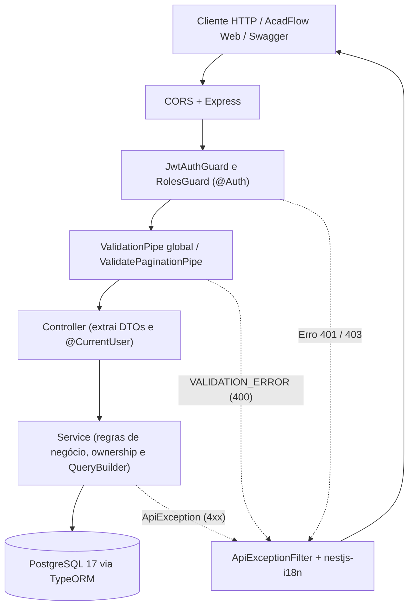
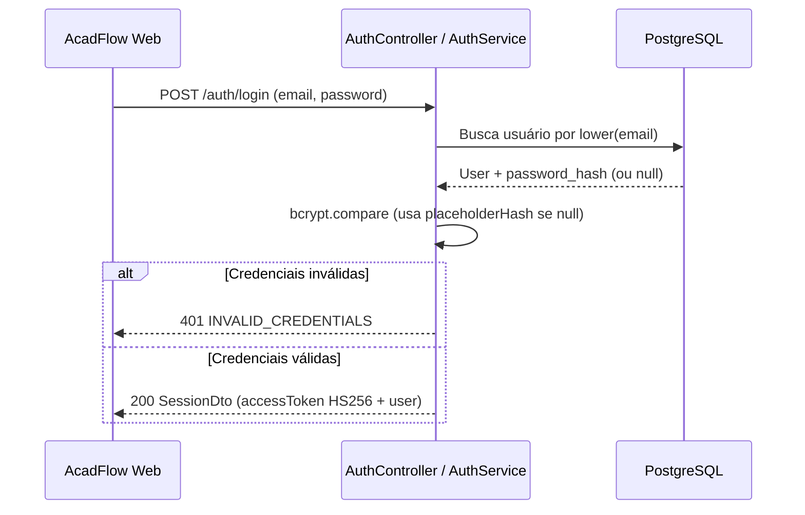
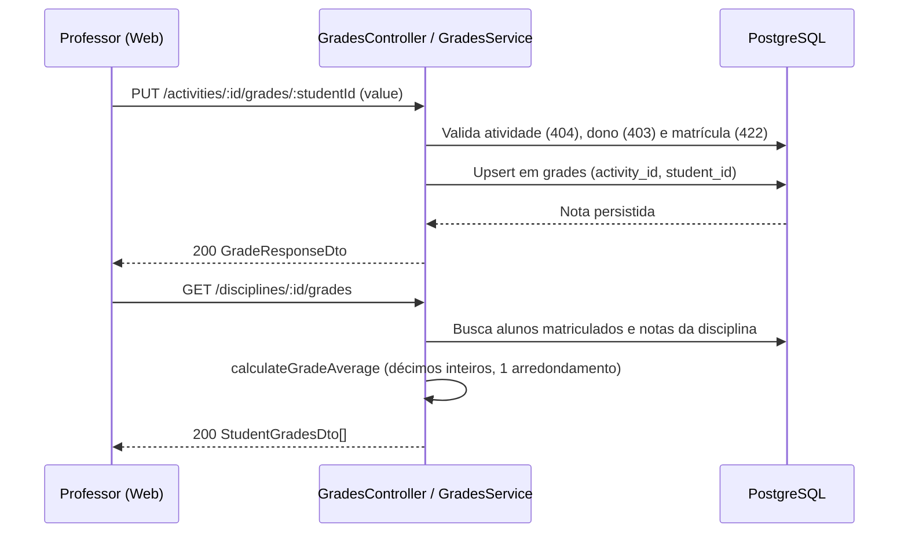

# AcadFlow API — Arquitetura

**Stack:** Node.js 24 · pnpm 12 · NestJS 12 · TypeScript 6 (`strict`) · PostgreSQL 17 · TypeORM · JWT + bcryptjs · Swagger/OpenAPI · `nestjs-i18n` · Vitest + Supertest · Oxlint/Oxfmt.  
**Repositórios:** [acadflow-web](https://github.com/DevCaverna/acadflow-web) · [acadflow-design](https://github.com/DevCaverna/acadflow-design)  
**Linear:** [Arquitetura API/Web, i18n, TanStack Query e Migrations](https://linear.app/acadflow/document/acadflow-arquitetura-apiweb-i18n-tanstack-query-e-migrations-15ff46ed6d06)

## Visão Geral

A API é um **monólito modular NestJS** organizado por domínio. A comunicação com o frontend ocorre exclusivamente via contrato HTTP/JSON documentado em [contratos-api.md](contratos-api.md) e exposto via Swagger em `/docs`.

```text
src/
  main.ts                        # Bootstrap Express, CORS, shutdown hooks e Swagger (/docs)
  app.module.ts                  # Config, TypeORM (autoLoadEntities), I18n, APP_PIPE, APP_FILTER
  config/                        # database.config.ts, security.constants.ts
  common/
    database/                    # Mapeamento de códigos de erro PostgreSQL (23505, 23503/23001)
    decorators/                  # @CurrentUser, @Roles, @Trim, @ApiErrors, @ApiListingResponse
    dto/                         # ApiErrorDto, Listing<T>, PaginationOptionsDto<Filter>
    filters/                     # ApiException, ApiExceptionFilter (global)
    guards/                      # RolesGuard
    pipes/                       # ValidatePaginationPipe<Filter>
    types/                       # Role, ErrorCode, ERROR_STATUS, ApiError
  database/
    data-source.ts               # DataSource CLI do TypeORM
    migrations/                  # Migrations manuais (InitialSchema, UseUuidV7)
    seeds/                       # Seeds idempotentes de desenvolvimento
  i18n/                          # Recursos pt-BR e en (common, errors, validation)
  modules/
    auth/                        # Login, /auth/me, @Auth(), JwtAuthGuard, JwtStrategy
    users/                       # Entidade User, UsersService, UserResponseDto
    disciplines/                 # CRUD e listagem paginada de disciplinas
    enrollments/                 # Consulta de alunos matriculados (matrícula manual em ACA-24)
    activities/                  # CRUD de atividades por disciplina
    grades/                      # Lançamento idempotente e cálculo de médias/situações
    health/                      # GET /health com verificação de SELECT 1 (timeout 3s)
    storage/                     # Reservado pós-MVP (implementado na branch ACA-25)
test/
  integration/                   # Testes de schema, UUID v7 e CLI de migrations em PG 17 Docker
  e2e/                           # Testes Supertest contra PostgreSQL 17 em Docker
scripts/                         # migration-create.mjs, run-docker-tests.mjs, deploy-api.sh
```

## Pipeline de Requisição e Camadas



### Responsabilidades por Camada

- **Controllers:** validam entrada (`ParseUUIDPipe`, `ValidatePaginationPipe`, `ValidationPipe`), declaram metadados OpenAPI (`@ApiTags`, `@ApiOperation`, `@ApiResponse`, `@ApiListingResponse`, `@ApiErrors`) e delegam ao service com objeto tipado.
- **Guards e Estratégia JWT (`@Auth(...roles)`):** `JwtAuthGuard` valida o token HS256 e carrega o usuário atual do banco via `JwtStrategy`; `RolesGuard` verifica `PROFESSOR` ou `ALUNO`.
- **Services:** concentram todas as regras de negócio, autorização de vínculo (`findOwnedOrFail`, `findVisibleOrFail`, `assertCanGrade`) e consultas via `QueryBuilder` com parâmetros nomeados.
- **DTOs de Resposta:** toda resposta passa por um DTO explícito (`*.from(entity)`), nunca expondo entidades brutas ou `passwordHash`.
- **Tratamento Global de Erros:** `ApiExceptionFilter` intercepta todas as exceções, traduz `errors.<code>` e `validation.*` usando `Accept-Language` (fallback `pt-BR`) e retorna `{ statusCode, code, message }`, sem vazar stack traces ou detalhes internos.

## Fluxos Principais

### 1. Autenticação e Validação de Sessão



### 2. Lançamento de Nota e Cálculo de Média



## Decisões Arquiteturais

- **Sem abstração extra de repository, filas ou cache externo:** o domínio do AcadFlow é coeso e atendido diretamente por TypeORM `Repository`/`QueryBuilder` nos services.
- **Migrations manuais sem `synchronize`:** `synchronize: false` e `migrationsRun: false` evitam alterações acidentais de schema e corridas entre réplicas em produção; detalhes em [migrations.md](migrations.md) e [banco-de-dados.md](banco-de-dados.md).
- **UUID v7 no PostgreSQL 17:** gerado por `public.uuid_generate_v7()` como `DEFAULT` das tabelas, garantindo ordenação temporal e PKs imprevisíveis (ver [ADR-0001](adr/0001-uuid-v7-no-postgresql-17.md)).
- **Paginação padronizada (`Listing<T>`):** `ValidatePaginationPipe` faz parse do JSON `filter` com `forbidNonWhitelisted: true`, restringe `sortField` à whitelist do recurso e adiciona desempate determinístico por `id ASC`.
- **Contratos e registros formais:** consulte também [swagger.md](swagger.md), [regras-de-negocio.md](regras-de-negocio.md), [seguranca.md](seguranca.md), [storage-e-operacao.md](storage-e-operacao.md) e [adr/README.md](adr/README.md).
