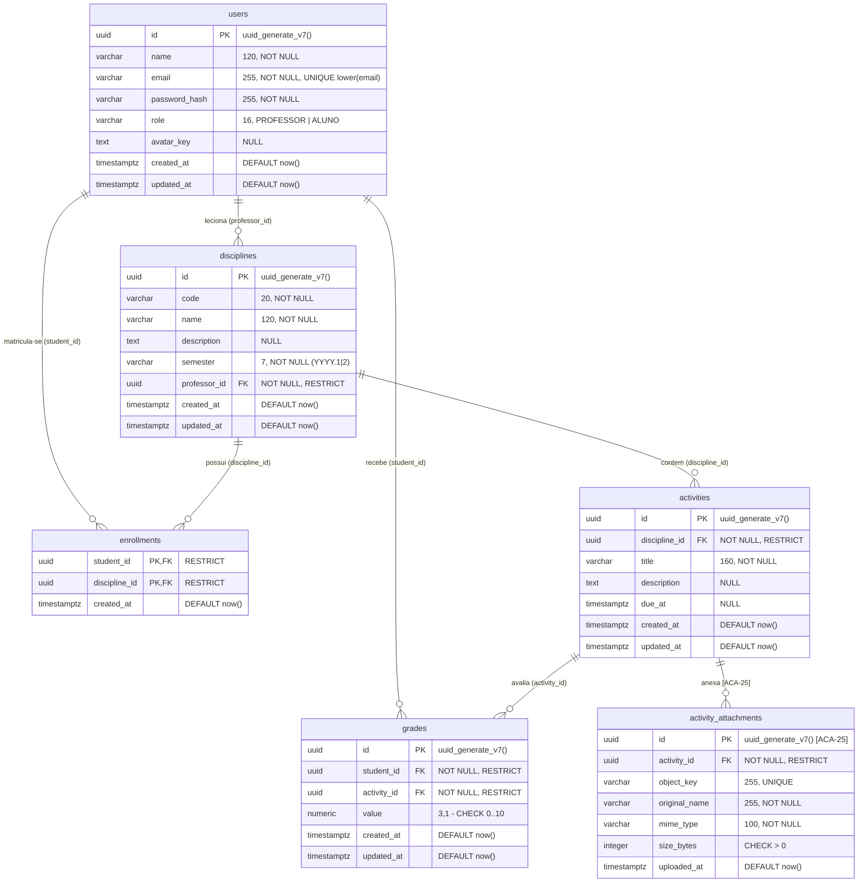

# Banco de Dados e Dicionário de Dados

O AcadFlow utiliza **PostgreSQL 17** com **TypeORM** (`synchronize: false`, `migrationsRun: false`). Todas as alterações de esquema passam por migrations manuais em `src/database/migrations/`.

## Diagrama Entidade-Relacionamento

> **Escopo por branch:** As 5 tabelas principais (`users`, `disciplines`, `enrollments`, `activities`, `grades`) são criadas pelas migrations ativas em `develop`/`main`. A tabela `activity_attachments` é pós-MVP e está implementada na branch `feature/ACA-25-storage-api`.

---

## Dicionário de Tabelas

### 1. `users`

Armazena professores e alunos autenticáveis no sistema.

| Coluna          | Tipo           | Nulo | Default                     | Restrições / Índices                                      |
| --------------- | -------------- | ---- | --------------------------- | --------------------------------------------------------- |
| `id`            | `uuid`         | Não  | `public.uuid_generate_v7()` | `PK`                                                      |
| `name`          | `varchar(120)` | Não  | —                           | —                                                         |
| `email`         | `varchar(255)` | Não  | —                           | `UQ_users_email` em `lower(email)` (case-insensitive)     |
| `password_hash` | `varchar(255)` | Não  | —                           | Hash bcrypt; nunca retornado por padrão (`select: false`) |
| `role`          | `varchar(16)`  | Não  | —                           | `CHK_users_role`: `role IN ('PROFESSOR', 'ALUNO')`        |
| `avatar_key`    | `text`         | Sim  | `NULL`                      | Chave do objeto no R2 (consumida na branch `ACA-25`)      |
| `created_at`    | `timestamptz`  | Não  | `now()`                     | Armazenado em UTC                                         |
| `updated_at`    | `timestamptz`  | Não  | `now()`                     | Armazenado em UTC                                         |

### 2. `disciplines`

Armazena as disciplinas ofertadas por semestre e vinculadas a um professor responsável.

| Coluna         | Tipo           | Nulo | Default                     | Restrições / Índices                                                                          |
| -------------- | -------------- | ---- | --------------------------- | --------------------------------------------------------------------------------------------- |
| `id`           | `uuid`         | Não  | `public.uuid_generate_v7()` | `PK`                                                                                          |
| `code`         | `varchar(20)`  | Não  | —                           | Compõe `UQ_disciplines_code_semester` com `semester`                                          |
| `name`         | `varchar(120)` | Não  | —                           | —                                                                                             |
| `description`  | `text`         | Sim  | `NULL`                      | —                                                                                             |
| `semester`     | `varchar(7)`   | Não  | —                           | Formato `YYYY.1` ou `YYYY.2`; imutável após criação                                           |
| `professor_id` | `uuid`         | Não  | —                           | `FK_disciplines_professor_id -> users(id) ON DELETE RESTRICT`, `IDX_disciplines_professor_id` |
| `created_at`   | `timestamptz`  | Não  | `now()`                     | Armazenado em UTC                                                                             |
| `updated_at`   | `timestamptz`  | Não  | `now()`                     | Armazenado em UTC                                                                             |

### 3. `enrollments`

Tabela associativa com chave primária composta que liga alunos (`ALUNO`) às disciplinas.

| Coluna          | Tipo          | Nulo | Default | Restrições / Índices                                                                                                   |
| --------------- | ------------- | ---- | ------- | ---------------------------------------------------------------------------------------------------------------------- |
| `student_id`    | `uuid`        | Não  | —       | `PK` (composta), `FK_enrollments_student_id -> users(id) ON DELETE RESTRICT`                                           |
| `discipline_id` | `uuid`        | Não  | —       | `PK` (composta), `FK_enrollments_discipline_id -> disciplines(id) ON DELETE RESTRICT`, `IDX_enrollments_discipline_id` |
| `created_at`    | `timestamptz` | Não  | `now()` | Armazenado em UTC                                                                                                      |

### 4. `activities`

Atividades avaliativas de uma disciplina. Não possui status de rascunho: toda atividade criada fica imediatamente visível aos alunos matriculados.

| Coluna          | Tipo           | Nulo | Default                     | Restrições / Índices                                                                                |
| --------------- | -------------- | ---- | --------------------------- | --------------------------------------------------------------------------------------------------- |
| `id`            | `uuid`         | Não  | `public.uuid_generate_v7()` | `PK`                                                                                                |
| `discipline_id` | `uuid`         | Não  | —                           | `FK_activities_discipline_id -> disciplines(id) ON DELETE RESTRICT`, `IDX_activities_discipline_id` |
| `title`         | `varchar(160)` | Não  | —                           | —                                                                                                   |
| `description`   | `text`         | Sim  | `NULL`                      | —                                                                                                   |
| `due_at`        | `timestamptz`  | Sim  | `NULL`                      | Prazo opcional em UTC (`ISO 8601` com fuso na API)                                                  |
| `created_at`    | `timestamptz`  | Não  | `now()`                     | Armazenado em UTC                                                                                   |
| `updated_at`    | `timestamptz`  | Não  | `now()`                     | Armazenado em UTC                                                                                   |

### 5. `grades`

Notas lançadas para um aluno em uma atividade. A ausência de registro significa **"sem nota"** (`NO_GRADES` na média quando não há nenhuma nota), nunca `0.0`.

| Coluna        | Tipo           | Nulo | Default                     | Restrições / Índices                                                                                        |
| ------------- | -------------- | ---- | --------------------------- | ----------------------------------------------------------------------------------------------------------- |
| `id`          | `uuid`         | Não  | `public.uuid_generate_v7()` | `PK`                                                                                                        |
| `student_id`  | `uuid`         | Não  | —                           | `FK_grades_student_id -> users(id) ON DELETE RESTRICT`, `IDX_grades_student_id`                             |
| `activity_id` | `uuid`         | Não  | —                           | `FK_grades_activity_id -> activities(id) ON DELETE RESTRICT`, `UQ_grades_activity_student` com `student_id` |
| `value`       | `numeric(3,1)` | Não  | —                           | `CHK_grades_value`: `value >= 0 AND value <= 10`                                                            |
| `created_at`  | `timestamptz`  | Não  | `now()`                     | Armazenado em UTC                                                                                           |
| `updated_at`  | `timestamptz`  | Não  | `now()`                     | Armazenado em UTC                                                                                           |

### 6. `activity_attachments` _(Pós-MVP — branch `feature/ACA-25-storage-api`)_

Metadados dos materiais de apoio anexados a atividades e armazenados em bucket privado R2.

| Coluna          | Tipo           | Nulo | Default                     | Restrições / Índices                                                                                               |
| --------------- | -------------- | ---- | --------------------------- | ------------------------------------------------------------------------------------------------------------------ |
| `id`            | `uuid`         | Não  | `public.uuid_generate_v7()` | `PK`                                                                                                               |
| `activity_id`   | `uuid`         | Não  | —                           | `FK_activity_attachments_activity_id -> activities(id) ON DELETE RESTRICT`, `IDX_activity_attachments_activity_id` |
| `object_key`    | `varchar(255)` | Não  | —                           | `UQ_activity_attachments_object_key`                                                                               |
| `original_name` | `varchar(255)` | Não  | —                           | Nome original do arquivo enviado                                                                                   |
| `mime_type`     | `varchar(100)` | Não  | —                           | `application/pdf`, `image/png` ou `image/jpeg`                                                                     |
| `size_bytes`    | `integer`      | Não  | —                           | `CHK_activity_attachments_size`: `size_bytes > 0`                                                                  |
| `uploaded_at`   | `timestamptz`  | Não  | `now()`                     | Armazenado em UTC                                                                                                  |

---

## Histórico de Migrations e UUID v7

| Timestamp       | Migration                              | O que faz                                                                                                                    |
| --------------- | -------------------------------------- | ---------------------------------------------------------------------------------------------------------------------------- |
| `1795463175245` | `InitialSchema`                        | Cria `users`, `disciplines`, `enrollments`, `activities` e `grades` com FKs `ON DELETE RESTRICT`, uniques, checks e índices. |
| `1795522438629` | `UseUuidV7`                            | Cria a função SQL `public.uuid_generate_v7()` e altera o `DEFAULT` da coluna `id` nas 4 tabelas com PK simples.              |
| `1795528902392` | `CreateActivityAttachments` _(ACA-25)_ | Cria a tabela `activity_attachments` para anexos de atividades.                                                              |

- **Por que `public.uuid_generate_v7()`?** O PostgreSQL 17 não possui `uuidv7()` nativo (introduzido apenas no PostgreSQL 18). A função SQL combina timestamp em milissegundos de `clock_timestamp()` (48 bits mais significativos) com bits aleatórios de `gen_random_uuid()` e marca versão `7` e variante RFC, gerando UUIDs ordenáveis cronologicamente e com boa localidade de índice B-Tree.

## Seeds de Desenvolvimento (`pnpm seed`)

Definidos em `src/database/seeds/seed-users.ts` e `src/database/seeds/seed-academic-data.ts`:

- **Proteções:** o runner recusa execução quando `NODE_ENV === 'production'` ou quando `SEED_PASSWORD` tem menos de 8 caracteres.
- **Idempotência:** utiliza `ON CONFLICT DO NOTHING` / `WHERE NOT EXISTS`, podendo ser executado repetidamente sem duplicar registros.
- **Dados criados:**
  - Usuários (`SEED_PASSWORD`): `professor@acadflow.local` (`PROFESSOR`), `aluno@acadflow.local` (`ALUNO`), `aluna@acadflow.local` (`ALUNO`).
  - Disciplina: `BD-204` — _Banco de Dados_ (`2026.2`), com os dois alunos matriculados.
  - Atividades: _Lista 1 - Modelagem_ e _Lista 2 - Normalização_.
