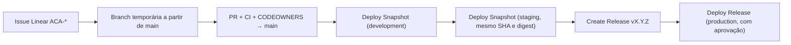

# Plano de Gerência de Configuração de Software (GCS) — AcadFlow API

Este documento formaliza o **Plano de Gerência de Configuração de Software** da **AcadFlow API**, alinhado à norma **IEEE Std 828 / ISO 10007 (SWEBOK)**, conectando os artefatos de código, banco de dados, CI/CD e releases já existentes aos quatro processos clássicos de GCS: **Identificação**, **Controle de Mudanças**, **Contabilização de Status** e **Auditorias**.

---

## 1. Objetivo, Escopo e Papéis (CCB)

- **Escopo:** cobre todos os artefatos versionados de `DevCaverna/acadflow-api` e sua integração por contrato HTTP/design com `DevCaverna/acadflow-web` e `DevCaverna/acadflow-design`.
- **Comitê de Controle de Mudanças (CCB):** atua por meio da revisão obrigatória de Pull Requests por código-proprietários (`.github/CODEOWNERS`), checks automáticos do GitHub Actions e aprovação manual explícita no Environment `production` (com autoaprovação bloqueada).

| Papel no Projeto                         | Responsável (GitHub) | Atuação em GCS                                                        |
| ---------------------------------------- | -------------------- | --------------------------------------------------------------------- |
| Infraestrutura, Auth, Banco e CI/CD      | `@aqu1no1`           | Migrations, Docker, pipelines GHCR/VPS, autenticação e segurança      |
| Domínio da API, Testes e Documentação    | `@Vinicius-Antonio`  | Módulos acadêmicos, testes unitários/E2E, contratos e PGC             |
| Integração Web e Alinhamento de Contrato | `@OtavioGonzaga`     | Consistência de contratos REST com `acadflow-web` e `acadflow-design` |

---

## 2. Identificação de Configuração

### 2.1 Catálogo de Itens de Configuração (ICs)

| ID          | Item de Configuração                 | Localização                                          | Versionamento / Identificação                 | Responsável                                   |
| ----------- | ------------------------------------ | ---------------------------------------------------- | --------------------------------------------- | --------------------------------------------- |
| `IC-API-01` | Código-fonte da aplicação            | `src/`                                               | Git SHA + Tag SemVer `vX.Y.Z`                 | `@aqu1no1` / `@Vinicius-Antonio`              |
| `IC-API-02` | Manifesto e lockfile de dependências | `package.json`, `pnpm-lock.yaml`                     | Lockfile congelado (`--frozen-lockfile`)      | `@aqu1no1`                                    |
| `IC-API-03` | Migrations manuais do PostgreSQL 17  | `src/database/migrations/`                           | Timestamp TypeORM + classe (`up`/`down`)      | `@aqu1no1`                                    |
| `IC-API-04` | Suíte de testes e fixtures           | `test/`, `src/**/*.spec.ts`                          | Git SHA (executado por worker isolado)        | `@Vinicius-Antonio`                           |
| `IC-API-05` | Contêineres de dev, teste e produção | `docker/`                                            | Git SHA + Imagem OCI no GHCR                  | `@aqu1no1`                                    |
| `IC-API-06` | Pipelines CI/CD e scripts de entrega | `.github/workflows/`, `.github/scripts/`, `scripts/` | Git SHA (validado por `delivery.test.sh`)     | `@aqu1no1`                                    |
| `IC-API-07` | Contratos REST e OpenAPI             | `docs/contratos-api.md`, `src/main.ts` (`/docs`)     | Git SHA + alinhamento com `acadflow-web`      | `@aqu1no1` / `@Vinicius-Antonio`              |
| `IC-API-08` | Documentação técnica e ADRs          | `README.md`, `AGENTS.md`, `docs/`, `CHANGELOG.md`    | Git SHA + revisão em PR                       | `@Vinicius-Antonio`                           |
| `IC-API-09` | Configuração de ambiente e segredos  | `.env.example`, GitHub Environments                  | Template versionado; segredos fora do Git     | `@aqu1no1`                                    |
| `IC-API-10` | Artefato OCI, SBOM e Assinatura      | GHCR `acadflow-api`                                  | Digest `sha256:...` + SBOM SPDX + Cosign OIDC | Pipeline `Deploy Snapshot` / `Create Release` |

### 2.2 Linhas de Base (Baselines)

| Baseline                    | Origem                      | Critério de Congelamento                              | Uso                                                    |
| --------------------------- | --------------------------- | ----------------------------------------------------- | ------------------------------------------------------ |
| **Baseline de Design**      | `acadflow-design` (`main`)  | PR revisado (`v1.0` → `v1.3`)                         | Referência visual, tokens e regras de domínio          |
| **Baseline de Integração**  | Commit de `main`            | PR revisado + `API / Validate` e `API / Build` verdes | Snapshot em `development`                              |
| **Baseline de Homologação** | Deployment em `development` | Mesmo commit e digest implantados em `staging`        | Validação pré-produção                                 |
| **Baseline de Produção**    | Release `vX.Y.Z`            | Digest homologado em `staging` + aprovação humana     | Imagem assinada por digest + migration aplicada + SBOM |

### 2.3 Versionamento Semântico (`SemVer 2.0.0`)

As releases utilizam tags imutáveis `vX.Y.Z` no formato SemVer:

- **`MAJOR` (`X`):** quebra de contrato HTTP em `docs/contratos-api.md`, mudança incompatível de autenticação ou alteração destrutiva de schema sem retrocompatibilidade.
- **`MINOR` (`Y`):** novas funcionalidades retrocompatíveis (ex.: novos endpoints de perfil, matrículas manuais, storage R2) e novas migrations aditivas.
- **`PATCH` (`Z`):** correções de bugs, ajustes de segurança, melhorias de documentação ou pipelines sem quebra de contrato.

---

## 3. Controle de Mudanças e Fluxo de Branches

### 3.1 Fluxo Padrão e Fluxo de Hotfix Emergencial

### 3.2 Regras de Controle Aplicadas

1. **Vínculo de origem:** toda mudança nasce de uma issue `ACA-*` no Linear e utiliza branch `feature/ACA-<numero>-descricao` (ou `hotfix/ACA-<numero>-descricao` em emergências de produção).
2. **Análise de impacto prévia:** mudanças em rotas ou DTOs exigem atualização simultânea de [contratos-api.md](contratos-api.md), Swagger (`/docs`) e alinhamento com `acadflow-web`.
3. **Aprovação por `CODEOWNERS`:** alterações em `.github/workflows/`, `src/database/migrations/`, `docker/` e `docs/contratos-api.md` acionam revisão obrigatória dos mantenedores definidos em [.github/CODEOWNERS](../.github/CODEOWNERS).
4. **Proteção de branches e tags:** configure `main` para exigir PR e CI verde; proteja tags `v*` contra alteração e exclusão.
5. **Dependências sob controle:** o [.github/dependabot.yml](../.github/dependabot.yml) abre PRs semanais para `npm` (`pnpm`), `docker` e `github-actions` contra `main`, sempre passando pelo CI completo.

Hotfixes partem de `main` e seguem o mesmo fluxo de promoção, normalmente com uma release patch.

---

## 4. Contabilização de Status de Configuração (CSA)

A rastreabilidade ponta a ponta permite responder em qualquer momento **qual versão de código, digest OCI e migration está ativa em cada ambiente**:

- **Cadeia de rastreio:** `Issue ACA-*` → `PR & Commit SHA` → `Execução CI` → `GitHub Deployment (task acadflow-image)` → `Digest sha256` + `Tag vX.Y.Z` + `pnpm migration:show`.

### Matriz de Configuração por Ambiente

| Aspecto                | Local (Host / Compose Dev)              | `development`                               | `staging`                                   | `production`                                 |
| ---------------------- | --------------------------------------- | ------------------------------------------- | ------------------------------------------- | -------------------------------------------- |
| Origem do código       | `main` ou branch temporária             | Commit de `main`                            | Mesmo commit e digest de `development`      | Release `vX.Y.Z` do digest de `staging`      |
| Banco PostgreSQL 17    | Local ou container `postgres:17-alpine` | Banco exclusivo `development`               | Banco exclusivo `staging`                   | Banco exclusivo `production` + backup prévio |
| Execução de migrations | Manual (`pnpm migration:run`)           | Automática antes da troca (`deploy-api.sh`) | Automática antes da troca (`deploy-api.sh`) | Automática após confirmação de backup        |
| `pnpm seed`            | Permitido (`SEED_PASSWORD`)             | Não executado no deploy                     | Bloqueado se `NODE_ENV=production`          | Bloqueado por código (`NODE_ENV=production`) |
| `CORS_ORIGIN`          | `http://localhost:5173`                 | Origem pública Web `development`            | Origem pública Web `staging`                | Origem pública Web `production`              |
| Aprovação humana       | N/A                                     | Acionamento manual                          | Acionamento manual                          | Obrigatória sem autoaprovação                |
| Rollback rápido        | `git` / `docker compose down`           | Contêiner `-previous` na VPS                | Contêiner `-previous` na VPS                | Contêiner `-previous` se schema compatível   |

---

## 5. Auditorias de Configuração (FCA e PCA)

### 5.1 Auditoria Funcional de Configuração (FCA)

Verifica antes do aceite que o item de configuração cumpre os requisitos funcionais e de qualidade:

- [ ] `pnpm lint` (`oxlint --type-aware --deny-warnings`) com zero erros e zero warnings.
- [ ] `pnpm format:check` (`oxfmt --check`) aprovado em 100% dos arquivos.
- [ ] `pnpm typecheck` (`tsc --noEmit`) sem erros.
- [ ] Testes unitários (`pnpm test:unit`), integração (`initial-schema`, `uuid-v7`, `migration-cli`) e E2E (`pnpm test:docker`) passando em PostgreSQL 17 isolado.
- [ ] Contrato Swagger validado em `test/e2e/disciplines.e2e-spec.ts` e critérios de negócio (médias, RBAC, `409 RESTRICT`) atendidos.
- [ ] Revisão humana concluída conforme `.github/PULL_REQUEST_TEMPLATE.md`.

### 5.2 Auditoria Física de Configuração (PCA)

Verifica antes da promoção/release que o artefato entregue corresponde exatamente ao pacote aprovado:

- [ ] Dependências instaladas com `pnpm install --frozen-lockfile` (sem deriva de versões).
- [ ] Build reproduzido via `docker/Dockerfile` com `tsc-alias` resolvido em `dist/` e arquivos `i18n` copiados.
- [ ] Mesmo commit e digest `sha256` promovidos entre `development` → `staging` → `production`.
- [ ] Scan **Trivy** sem vulnerabilidades críticas bloqueantes.
- [ ] Assinatura criptográfica **Cosign / OIDC** e **SBOM SPDX** anexados à imagem no GHCR.
- [ ] Consistência entre tag `vX.Y.Z`, registro em [CHANGELOG.md](../CHANGELOG.md) e estado das migrations (`migration:show`).

---

## Referências

- [Arquitetura da API](arquitetura.md)
- [Banco de Dados e Migrations](banco-de-dados.md) · [Padrão de Migrations](migrations.md)
- [Pipeline CI](CI.md) · [Releases e Deploy](execucao/deploy.md)
- [Segurança](seguranca.md) · [Regras de Negócio](regras-de-negocio.md)
