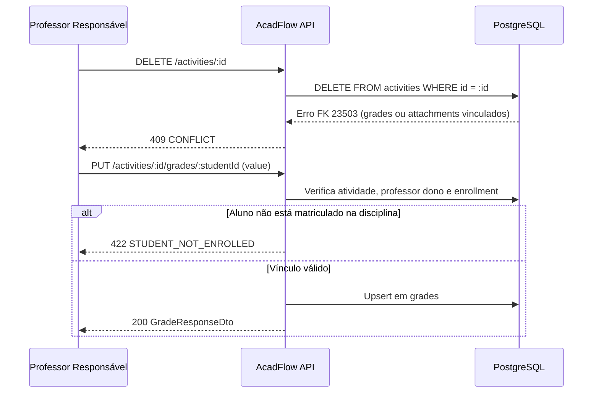

# Regras de Negócio e Matriz de Permissões

Este documento consolida todas as regras de domínio do **AcadFlow**, incluindo validações de notas, cálculo de médias, proteção contra exclusões e a matriz completa de autorização (**RBAC + Ownership / Vínculo**).

---

## 1. Papéis e Acesso

- Existem exclusivamente dois papéis (`Role`): `PROFESSOR` e `ALUNO`.
- O cliente **nunca** define seu próprio papel em requisições autenticadas: a identidade vem do `sub` do JWT validado no banco em toda requisição (`JwtStrategy`).
- No MVP, contas e matrículas são criadas via seed (`pnpm seed`). Nas branches pós-MVP (`ACA-24`), usuários também podem ser criados via CLI administrativa (`pnpm user:create`) e matrículas gerenciadas pelo professor dono da disciplina.

---

## 2. Disciplinas

- **Unicidade:** o par `(code, semester)` é único no banco (`UQ_disciplines_code_semester`). Tentar criar uma disciplina com código e semestre já existentes retorna `409 CONFLICT`.
- **Formato de semestre:** `YYYY.1` ou `YYYY.2` (ex.: `2026.2`).
- **Imutabilidade após criação:** `PATCH /disciplines/:id` permite alterar apenas `name` e `description` (`null` ou string vazia limpa a descrição). `code` e `semester` não podem ser alterados.
- **Visibilidade na listagem (`GET /disciplines`):**
  - `PROFESSOR`: vê somente as disciplinas em que é o `professorId`.
  - `ALUNO`: vê somente as disciplinas em que possui registro em `enrollments`.
- **Exclusão (`DELETE /disciplines/:id`):** bloqueada com `409 CONFLICT` caso existam alunos matriculados ou atividades vinculadas (`ON DELETE RESTRICT`).

---

## 3. Atividades

- **Visibilidade imediata:** não existe estado de rascunho nem publicação manual. Ao ser criada (`POST /disciplines/:id/activities`), a atividade fica imediatamente visível ao professor responsável e aos alunos matriculados.
- **Ordenação padrão (`GET /disciplines/:id/activities`):** ordenada por `dueAt ASC NULLS LAST`, com desempate por `id ASC`.
- **Campos opcionais:** `description` e `dueAt` são opcionais e podem ser limpos enviando `null` em `PATCH /activities/:id`. Quando informado, `dueAt` exige data, hora e fuso horário no padrão ISO 8601 (ex.: `2026-11-25T23:59:00Z`).
- **Exclusão (`DELETE /activities/:id`):** bloqueada com `409 CONFLICT` caso existam notas lançadas (`ON DELETE RESTRICT`). Na branch pós-MVP `ACA-25`, a existência de anexos também bloqueia a exclusão com `409 CONFLICT`.

---

## 4. Notas, Médias e Situação Acadêmica

### Regras de Lançamento

- **Faixa permitida:** `0` a `10`, com no máximo **1 casa decimal** (`IsNumber({ maxDecimalPlaces: 1 })`).
- **Ausência de nota:** uma atividade sem registro em `grades` representa **"sem nota"** — **nunca** é salva como `0` e **não** entra no denominador da média.
- **Idempotência (`PUT /activities/:id/grades/:studentId`):** realiza `upsert` pela chave `(activityId, studentId)`. Repetir a chamada atualiza o valor existente sem duplicar registro.
- **Vínculo obrigatório:** tentar lançar nota para um usuário que não está matriculado na disciplina da atividade retorna `422 STUDENT_NOT_ENROLLED`.

### Algoritmo de Cálculo e Classificação (`calculateGradeAverage`)

1. Se não houver nenhuma nota lançada para o aluno na disciplina:
   - `average = null`
   - `status = 'NO_GRADES'`
2. Caso haja $n \ge 1$ notas lançadas:
   - Converte cada nota para décimos inteiros (`Math.round(value * 10)`), evitando desvios de ponto flutuante.
   - Calcula a média aritmética apenas das $n$ notas lançadas e arredonda **uma única vez** para 1 casa decimal (`Math.round(somaEmDecimos / n) / 10`).
   - Classifica o aluno usando a média **já arredondada**:

| Média arredondada       | `GradeStatus` | Exibição no Frontend (`pt-BR`) |
| ----------------------- | ------------- | ------------------------------ |
| Sem notas lançadas      | `NO_GRADES`   | Sem notas                      |
| $\ge 7{,}0$             | `APPROVED`    | Aprovado                       |
| $\ge 5{,}0$ e $< 7{,}0$ | `RECOVERY`    | Recuperação                    |
| $< 5{,}0$               | `FAILED`      | Reprovado                      |

> Enquanto existirem atividades na disciplina sem nota para aquele aluno, a interface web exibe a média e a situação como **parciais**, indicando quantas atividades já possuem nota.

### Exemplos Práticos de Arredondamento

| Notas lançadas | Média exata | Média arredondada (1 casa) | `GradeStatus` |
| -------------- | ----------- | -------------------------- | ------------- |
| _(nenhuma)_    | —           | `null`                     | `NO_GRADES`   |
| `6.9` e `7.0`  | `6.95`      | `7.0`                      | `APPROVED`    |
| `6.8` e `7.0`  | `6.90`      | `6.9`                      | `RECOVERY`    |
| `4.9` e `5.0`  | `4.95`      | `5.0`                      | `RECOVERY`    |
| `4.8` e `5.0`  | `4.90`      | `4.9`                      | `FAILED`      |

---

## 5. Matriz de Permissões (RBAC + Ownership)

> Legenda de atores: **Público** (sem JWT) · **Aluno (não matr.)** (JWT `ALUNO` sem matrícula na disciplina) · **Aluno (matr.)** (JWT `ALUNO` matriculado) · **Prof. (outro)** (JWT `PROFESSOR` de outra disciplina) · **Prof. (dono)** (JWT `PROFESSOR` responsável pela disciplina).

| Operação            | Rota                                    | Público       | Aluno (não matr.) | Aluno (matr.)     | Prof. (outro)     | Prof. (dono)      |
| ------------------- | --------------------------------------- | ------------- | ----------------- | ----------------- | ----------------- | ----------------- |
| Saúde               | `GET /health`                           | `200` / `503` | `200` / `503`     | `200` / `503`     | `200` / `503`     | `200` / `503`     |
| Login               | `POST /auth/login`                      | `200` / `401` | `200` / `401`     | `200` / `401`     | `200` / `401`     | `200` / `401`     |
| Sessão atual        | `GET /auth/me`                          | `401`         | `200`             | `200`             | `200`             | `200`             |
| Listar disciplinas  | `GET /disciplines`                      | `401`         | `200` _(só suas)_ | `200` _(só suas)_ | `200` _(só suas)_ | `200` _(só suas)_ |
| Criar disciplina    | `POST /disciplines`                     | `401`         | `403`             | `403`             | `201` / `409`     | `201` / `409`     |
| Ver disciplina      | `GET /disciplines/:id`                  | `401`         | `403`             | `200`             | `403`             | `200`             |
| Editar disciplina   | `PATCH /disciplines/:id`                | `401`         | `403`             | `403`             | `403`             | `200`             |
| Excluir disciplina  | `DELETE /disciplines/:id`               | `401`         | `403`             | `403`             | `403`             | `204` / `409`     |
| Listar matriculados | `GET /disciplines/:id/students`         | `401`         | `403`             | `403`             | `403`             | `200`             |
| Listar atividades   | `GET /disciplines/:id/activities`       | `401`         | `403`             | `200`             | `403`             | `200`             |
| Criar atividade     | `POST /disciplines/:id/activities`      | `401`         | `403`             | `403`             | `403`             | `201`             |
| Editar atividade    | `PATCH /activities/:id`                 | `401`         | `403`             | `403`             | `403`             | `200`             |
| Excluir atividade   | `DELETE /activities/:id`                | `401`         | `403`             | `403`             | `403`             | `204` / `409`     |
| Lançar/editar nota  | `PUT /activities/:id/grades/:studentId` | `401`         | `403`             | `403`             | `403`             | `200` / `422`     |
| Ver notas da turma  | `GET /disciplines/:id/grades`           | `401`         | `403`             | `403`             | `403`             | `200`             |
| Ver próprias notas  | `GET /disciplines/:id/grades/me`        | `401`         | `403`             | `200`             | `403`             | `403`             |

### Fluxos de Bloqueio e Erro de Negócio

